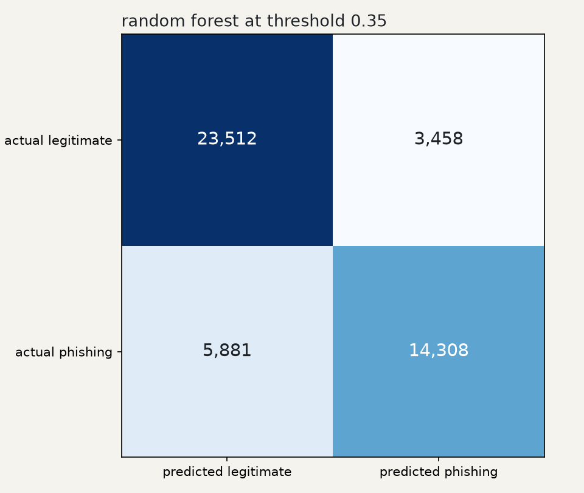
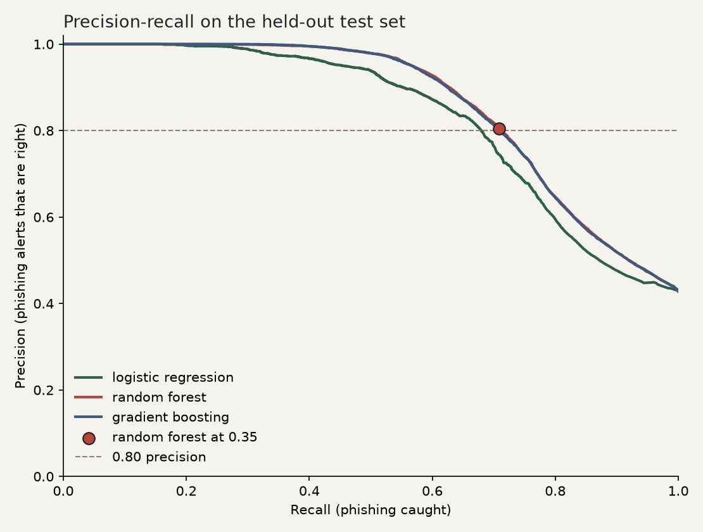

# Phishing URL Checker

A small Python tool that scores a URL for phishing risk. It looks only at the
text of the link. It never opens the page, never follows a redirect, and never
downloads anything from the URL you give it.

The features are lexical facts about the hostname. Three scikit-learn models
are trained on the same rows: logistic regression, a random forest, and
histogram gradient boosting. The checker that `train.py` saves is the random
forest, with the decision threshold set to 0.35. That choice is explained
below. It was measured, not guessed.


## How the code is organized

The program is a package called `phishguard`. Each class has one job.

| File | What it is |
|---|---|
| `phishguard/features.py` | `FeatureExtractor`, an abstract base class, and `LexicalExtractor`, the hostname features |
| `phishguard/models.py` | `Model`, the classifier interface, plus logistic regression, the forest, and gradient boosting |
| `phishguard/registry.py` | `ModelRegistry`, which hands out a model when you ask for it by name |
| `phishguard/pipeline.py` | `Pipeline`, which connects the extractors to the model |
| `phishguard/verdict.py` | `Verdict`, the result for one URL, and `Metrics`, the scores for a test set |
| `phishguard/evaluate.py` | The train/test split, the metric math, and the threshold rule |
| `phishguard/compare.py` | Fits all three models and writes `comparison.json` |
| `phishguard/config.py` | The frozen model name and threshold that `train.py` uses |
| `phishguard/cli.py` | The command-line checker |
| `checker.py`, `train.py`, `compare.py` | Short entry points that call the package |

A few object-oriented ideas show up on purpose:

- An **abstract base class** (`FeatureExtractor`, `Model`) lists the methods a
  subclass must provide. You cannot construct the base class itself. That is
  the contract. `LexicalExtractor` and the three model classes fill it in.
- **Composition** is how `Pipeline` is built. It holds one or more extractors
  and one model, rather than inheriting from them. To try a different model
  you pass a different object. The pipeline code stays the same.
- The **strategy pattern** is `ModelRegistry`. The comparison loop asks for
  `"random_forest"` and gets back a new `Model`. Adding a fourth algorithm
  means registering a builder, not editing the loop.
- A **dataclass** (`Verdict`) is a small frozen record: the URL, the
  probability, the risk band, and the reasons. Frozen means nothing mutates
  it after it is created.
- `fit` on `Model` is a **template method**. The base class checks that the
  model has been trained. The subclass only fills in how training works.
  `SklearnProbabilityModel` shares the scikit-learn `fit` / `predict_proba`
  plumbing. `LogisticModel` overrides that with weights you can read.

`LexicalExtractor` reads the hostname: length, dots, hyphens, an IP host,
subdomain depth, credential keywords (`login`, `verify`, `secure`, `account`,
`update`, and a few more), Shannon entropy, a short risky-TLD list, the digit
ratio, and a list of known URL shorteners. A leading `www.` is ignored for
those counts.

Rule flags on the full URL (`@` in the URL, no HTTPS, a keyword in the path)
are printed as extra reasons. They are not features of the model. The
limitations section explains why.

The checker prints three bands. With the shipped threshold of 0.35, a
probability under 0.35 is LIKELY SAFE, 0.35 up to but not including 0.80 is
SUSPICIOUS, and 0.80 or more is LIKELY PHISHING. The metrics below use one
cutoff. Both SUSPICIOUS and LIKELY PHISHING count as a phishing prediction.
LIKELY SAFE counts as legitimate.

Logistic regression can also list the features that pushed a score up
(`keyword_hits (+6.67)` and so on). The forest cannot. The shipped checker
prints rule flags only, so a short link with no flag can come back as
phishing with no reason under it. That is the cost of the recall gain.

## Run

```bash
python -m venv .venv
source .venv/bin/activate
pip install -r requirements.txt
python train.py
python checker.py "hxxp://paypal-account-verify[.]secure-login[.]tk/signin"
python checker.py --weights
python compare.py
```

`python -m phishguard` does the same thing as `python checker.py`. Defanged
input (`hxxp`, `[.]`) is accepted. `train.py` writes `model.joblib` and
`metrics.json`. `compare.py` retrains all three models, rewrites those files
with the winning model, and writes `comparison.json`, `confusion_matrix.png`,
and `pr_curve.png`.

The shipped forest has no single weight per feature, so `--weights` says so.
The bar chart further down is the logistic regression, which does have weights.

Tests and lint use the dev requirements. The tests score a handful of made-up
URLs. They do not download the dataset.

```bash
pip install -r requirements-dev.txt
ruff check .
ruff format --check .
pytest
```

`pytest -m dataset` also refits the logistic baseline and the shipped forest
when `data/PhiUSIIL_Phishing_URL_Dataset.csv` is on disk. CI does not run that
marker.

## Dataset

[PhiUSIIL Phishing URL Dataset](https://archive.ics.uci.edu/dataset/967/phiusiil+phishing+url+dataset)
(UCI Machine Learning Repository, CC BY 4.0). It has 235,795 URLs: 134,850
legitimate and 100,945 phishing. Prasad, A. & Chandra, S. (2024). PhiUSIIL: A
diverse security profile empowered phishing URL detection framework. Computers
& Security.

The CSV is not in git. Download it once, into `data/`, before training:

```bash
mkdir -p data
curl -L -o /tmp/phiusiil.zip "https://archive.ics.uci.edu/static/public/967/phiusiil+phishing+url+dataset.zip"
unzip -o /tmp/phiusiil.zip -d data
```

The file's `label` column uses `1` for legitimate. The trainer flips that so
`1` means phishing, which is the class the precision and recall numbers
describe.

## How the comparison was run

Every model sees the same hostname features and the same holdout.

1. Split the 235,795 URLs into 188,636 training and 47,159 test rows. The
   split is stratified, 80/20, seed 42. This is the original baseline split.
   The test rows are not used to fit a model or to pick a threshold.
2. Cut the training rows again, with the same kind of split, into 150,908
   fit rows and 37,728 validation rows.
3. Fit each model on the fit rows. On the validation rows, search thresholds
   0.05, 0.06, ... 0.95. Keep the threshold with the highest phishing recall
   whose precision is still at least 0.80. If two thresholds tie, keep the
   higher one. If none reach 0.80 precision, keep the one with the best F1.
4. The model with the highest validation recall, among those that held the
   0.80 precision floor, is the winner. Ties would go to precision, then to
   the simpler model (logistic, then forest, then boosting).
5. Refit every model on the full 188,636 training rows. Score the 47,159 test
   URLs once, at 0.5 and at the threshold chosen in step 3.

On the validation slice the measured recalls at the chosen thresholds were:

| Model | Threshold | Validation precision | Validation recall |
|---|---|---|---|
| Logistic regression | 0.44 | 80.52% | 66.30% |
| Random forest | 0.35 | 80.08% | 70.15% |
| Gradient boosting | 0.38 | 80.06% | 69.84% |

The forest won that comparison. `config.py` freezes `random_forest` and
`0.35` so `train.py` rebuilds that choice. The unrounded validation scores
are in `comparison.json`.

Lowering the threshold is the recall lever. A URL is called phishing when its
probability is at least the threshold. A lower threshold catches more real
phishing and also flags more legitimate URLs. The 0.80 floor is the "still
reasonable" part of that trade: at least four out of five phishing alerts on
the validation slice had to be right before a lower threshold was allowed.

The hyperparameters were not searched. Logistic regression is a
`StandardScaler` plus `LogisticRegression(max_iter=1000)`. The forest is 200
trees, depth at most 16, at least 5 rows per leaf, `random_state=42`. Gradient
boosting is scikit-learn's `HistGradientBoostingClassifier` (200 iterations,
learning rate 0.1, depth at most 6, early stopping off, `random_state=42`),
which is the gradient boosting implementation that fits this table in
reasonable time. The older `GradientBoostingClassifier` was not trained.

## Results

Percentages below are the measured scores rounded to two decimal places.
`comparison.json` stores the unrounded floats and the confusion counts.
Precision, recall, and F1 are for the phishing class.

| Model | Threshold | Accuracy | Precision | Recall | F1 |
|---|---|---|---|---|---|
| Logistic regression (baseline) | 0.50 | 79.30% | 85.62% | 62.07% | 71.97% |
| Logistic regression | 0.44 | 79.32% | 81.27% | 67.17% | 73.55% |
| Random forest | 0.50 | 81.04% | 87.99% | 64.52% | 74.45% |
| Random forest (shipped) | 0.35 | 80.20% | 80.54% | 70.87% | 75.39% |
| Gradient boosting | 0.50 | 80.95% | 87.82% | 64.45% | 74.34% |
| Gradient boosting | 0.38 | 79.92% | 79.87% | 70.97% | 75.16% |

The baseline row matches the original checker exactly: accuracy
0.7929769503170127, precision 0.8561765509702104, recall 0.6206845311803457,
and the confusion matrix below. F1 for that same prediction is
0.7196554199569275. At one decimal place those are the 79.3%, 85.6%, and
62.1% from the original write-up.

Baseline confusion matrix (rows actual, columns predicted):

|  | pred legit | pred phish |
|---|---|---|
| legit | 24,865 | 2,105 |
| phish | 7,658 | 12,531 |

Shipped forest at 0.35, same test rows:

|  | pred legit | pred phish |
|---|---|---|
| legit | 23,512 | 3,458 |
| phish | 5,881 | 14,308 |

Against the baseline, the shipped model catches 1,777 phishing URLs the
baseline missed (7,658 misses down to 5,881) and adds 1,353 false alarms
(2,105 up to 3,458). Net correct predictions go up by 424, which is why
accuracy rises from 79.30% to 80.20% even while precision falls from 85.62%
to 80.54%. Recall rises from 62.07% to 70.87%. F1 rises from 71.97% to 75.39%.





The curves are the three refit models on the test set. The star is the
shipped forest's measured precision and recall at 0.35. The dashed line is
0.80 precision, drawn as a reference. The threshold was not chosen by looking
at this chart.

At threshold 0.5, before any threshold change, the forest and the boosting
model both beat logistic regression on accuracy, precision, recall, and F1.
The larger recall jump comes from the lower threshold, and it costs precision.

On the test set, boosting at its validation threshold of 0.38 has recall
70.97% and precision 79.87%. That recall is a little higher than the forest's
70.87%, and that precision is just under the 0.80 floor. The winner was
locked from the validation scores, where the forest's recall was higher
(70.15% versus 69.84%) and both precisions were at least 0.80. The test set
was not used to change that decision.


Positive weights push a URL toward phishing. This chart is the logistic
model only. The forest does not have one signed weight per feature.
`num_dots` and `subdomain_depth` are almost the same measurement
(`subdomain_depth` is dots minus one), so those two weights should not be
read as independent effects.

## Limitations

- An earlier version of this project also used full-URL length, path length,
  and HTTPS. That version's write-up reported 99.6% accuracy. It was not
  detecting phishing. It was learning "has a path or uses http", because
  every legitimate URL in this dataset is an `https://` homepage. I did not
  remeasure that earlier setup. Hostname-only features are the setup measured
  here.
- The threshold was chosen on a model fit on 150,908 rows, then applied to a
  model refit on all 188,636 training rows. Those two models do not produce
  identical probabilities, so the threshold is not perfectly tuned for the
  saved model. That is visible in the boosting row: validation precision was
  80.06%, and test precision came out 79.87%.
- Hyperparameters were not grid-searched. A different depth or number of
  trees could move these numbers. Only the three settings in `models.py`
  were trained.
- It is still a lexical model. It cannot see page content, certificates,
  domain age, or reputation. Phishing on a clean-looking or compromised
  domain is easy for it to miss. Even the shipped model misses 5,881 of
  20,189 phishing URLs in the holdout.
- This is a learning project, not a production security control.
