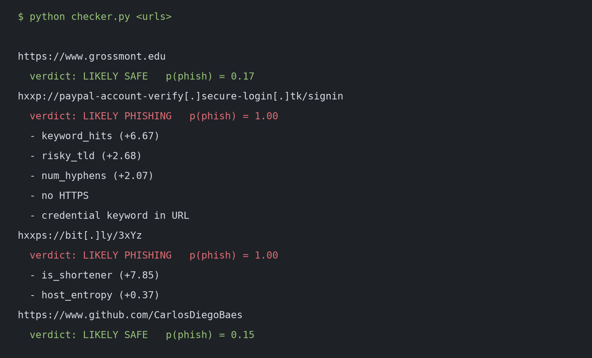
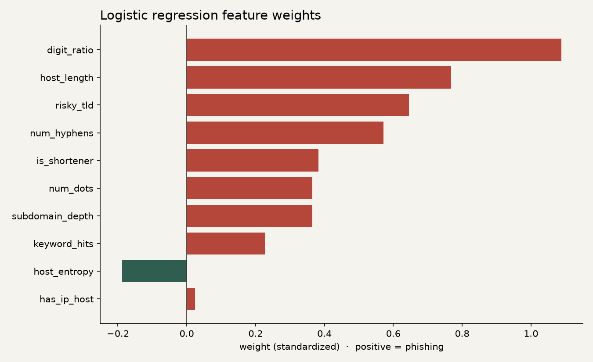

# Phishing URL Checker

A small Python tool that scores a URL for phishing risk. It looks only at the
text of the link. It never opens the page, never follows a redirect, and never
downloads anything from the URL you give it.

The model is a logistic regression from scikit-learn. Logistic regression is
a straight-line classifier: each feature gets a weight, the weights are added
up, and that sum becomes a probability. The weights are readable, which makes
the model a good first one to study.



## How the code is organized

The program is a package called `phishguard`. The pieces are small classes
with one job each, so you can read them in order.

| File | What it is |
|---|---|
| `phishguard/features.py` | `FeatureExtractor`, an abstract base class, and `LexicalExtractor`, the hostname features |
| `phishguard/models.py` | `Model`, the classifier interface, and `LogisticModel`, the logistic regression |
| `phishguard/pipeline.py` | `Pipeline`, which connects the extractors to the model |
| `phishguard/verdict.py` | `Verdict`, the result for one URL, and `Metrics`, the holdout scores |
| `phishguard/evaluate.py` | The train/test split and the metric calculations |
| `phishguard/cli.py` | The command-line checker |
| `phishguard/train.py` | Training on the PhiUSIIL CSV |
| `checker.py`, `train.py` | Short entry points that call the package |

A few object-oriented ideas show up on purpose:

- An **abstract base class** (`FeatureExtractor`, `Model`) lists the methods a
  subclass must provide. You cannot construct the base class itself. That is
  the contract. `LexicalExtractor` and `LogisticModel` are the concrete classes
  that fill the contract in.
- **Composition** is how `Pipeline` is built. It holds one or more extractors
  and one model, rather than inheriting from them. To try a different model
  you pass a different object. The pipeline code stays the same.
- A **dataclass** (`Verdict`) is a small frozen record: the URL, the
  probability, the risk band, and the reasons. Frozen means nothing mutates
  it after it is created.
- `fit` on `Model` is a **template method**. The base class checks that the
  model has been trained. The subclass only fills in how training works.

`LexicalExtractor` reads the hostname: length, dots, hyphens, an IP host,
subdomain depth, credential keywords (`login`, `verify`, `secure`, `account`,
`update`, and a few more), Shannon entropy, a short risky-TLD list, the digit
ratio, and a list of known URL shorteners. A leading `www.` is ignored for
those counts.

Rule flags on the full URL (`@` in the URL, no HTTPS, a keyword in the path)
are printed as extra reasons. They are not features of the model. The
limitations section explains why.

## Run

```bash
python -m venv .venv
source .venv/bin/activate
pip install -r requirements.txt
python train.py
python checker.py "hxxp://paypal-account-verify[.]secure-login[.]tk/signin"
python checker.py --weights
```

`python -m phishguard` does the same thing as `python checker.py`. Defanged
input (`hxxp`, `[.]`) is accepted. `train.py` writes `model.joblib` and
`metrics.json` in the project root.

Tests and lint use the dev requirements. The tests score a handful of made-up
URLs. They do not download the dataset.

```bash
pip install -r requirements-dev.txt
ruff check .
ruff format --check .
pytest
```

## Dataset

[PhiUSIIL Phishing URL Dataset](https://archive.ics.uci.edu/dataset/967/phiusiil+phishing+url+dataset)
(UCI Machine Learning Repository, CC BY 4.0). It has 235,795 URLs: 134,850
legitimate and 100,945 phishing. Prasad, A. & Chandra, S. (2024). PhiUSIIL: A
diverse security profile empowered phishing URL detection framework. Computers
& Security.

The CSV is not in git. Download it once, into `data/`, before training:

```bash
mkdir -p data
curl -L -o /tmp/phiusiil.zip "https://archive.ics.uci.edu/static/public/967/phiusiil+phishing+url+dataset.zip"
unzip -o /tmp/phiusiil.zip -d data
```

The file's `label` column uses `1` for legitimate. The trainer flips that so
`1` means phishing, which is the class the precision and recall numbers
describe.

## Results

These numbers are from an 80/20 stratified split, seed 42, with 188,636
training URLs and 47,159 test URLs. The decision threshold is 0.5. I
re-ran the trainer on scikit-learn 1.9.1 and got the same counts as the
original checker.

| Metric | Value |
|---|---|
| Accuracy | 79.3% |
| Precision (phishing) | 85.6% |
| Recall (phishing) | 62.1% |
| F1 (phishing) | 72.0% |

Confusion matrix (rows are the actual class, columns are the prediction):

|  | pred legit | pred phish |
|---|---|---|
| legit | 24,865 | 2,105 |
| phish | 7,658 | 12,531 |

F1 was not in the original write-up. On this same holdout it is
0.7196554199569275, which rounds to 72.0%. `metrics.json` stores that value
along with the threshold and the feature weights.



Positive weights push a URL toward phishing. `num_dots` and `subdomain_depth`
are almost the same measurement (`subdomain_depth` is dots minus one), so
those two weights should not be read as independent effects.

## Limitations

- An earlier version of this project also used full-URL length, path length,
  and HTTPS. That version's write-up reported 99.6% accuracy. It was not
  detecting phishing. It was learning "has a path or uses http", because
  every legitimate URL in this dataset is an `https://` homepage. I did not
  remeasure that earlier setup. Hostname-only features are the more honest
  one, and 79.3% accuracy is the number this setup produces on the holdout
  above.
- It is a lexical model. It cannot see page content, certificates, domain age,
  or reputation. Phishing on a clean-looking or compromised domain is easy
  for it to miss. Recall is 62.1%, so it misses a large share of the phishing
  URLs in the holdout.
- This is a learning project, not a production security control.
